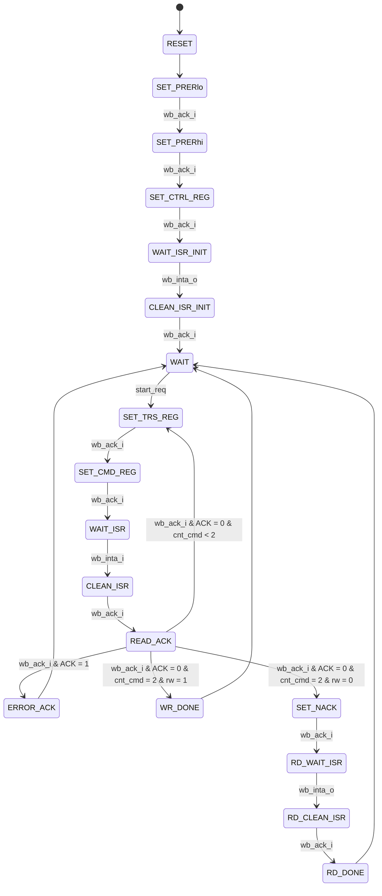
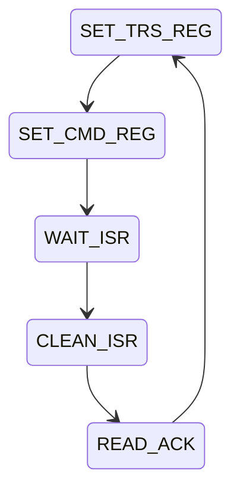

# fonctionnement détaillé du séquenceur I2C

# Description des états

## Initialisation 

Pendant l'initialisation, le séquenceur vient paramètrer l'IP I2C_CORE. 

| Etat         | Description | 
|--------------|-------------|
|`SET_PRERlo`  | paramétrage des prescale |
|`SET_PRERhi`  | paramétrage des prescale |
|`SET_CTRL_REG`| Enable de l'IP + activation ISR |

## Fonctionnement nominal

L'IP passe dans l'état `WAIT` et attend de recevoir un `start_req`

`rw`, `dev_addr`, `reg_addr` et `wr_data` sont stocké en registre au changement d'état.

L'IP répète ensuite 3 fois une suite d'état qui permet de réaliser une transaction I2C.

Un compteur `cnt_cmd` compte le nombre de transaction I2C réalisé. 
En fonction du compteur, les entrées des états ne sont pas les mêmes. 

On distingue deux modes de fonctionnement : WRITE et READ

Voici les états de transactions I2C en fonction du compteur `cnt_cmd`

En mode WRITE : 

| cnt_cmd | STA | STO | WR | DATA |
|---------|-----|-----|----|------|
| 0       | 1   | 0   | 1  | adresse_I2C |
| 1       | 0   | 0   | 1  | adresse_registre |
| 2       | 0   | 1   | 1  | donnée |

En mode READ : 

| cnt_cmd | STA | STO | WR | DATA |
|---------|-----|-----|----|------|
| 0       | 1   | 0   | 1  | adresse_I2C |
| 1       | 0   | 0   | 1  | adresse_registre |
| 2       | 1   | 0   | 1  | adresse_I2C |

